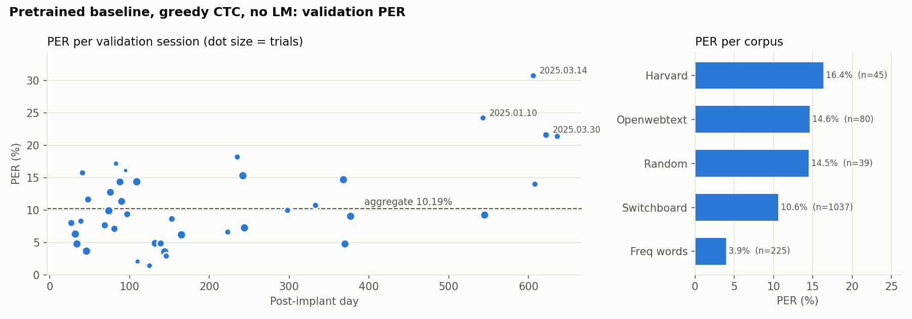

# Brain-to-Text '25 baseline reproduction on Apple Silicon

Reproduction of the phoneme decoding baseline from the Brain-to-Text '25 benchmark (Card et al., *NEJM* 2024). The baseline is a GRU that decodes phonemes from intracortical recordings of speech motor cortex in a participant with ALS (512 features at 20 ms, 45 sessions over 20 months). This repo runs the upstream CUDA code on a MacBook (M1 Max, MPS) without modifying it. Next, it will test whether data augmentation methods from automatic speech recognition make decoding more robust.

## Results so far

### Phoneme error rate matches the published baseline

| | Val PER (greedy CTC, no language model) |
|---|---|
| Published (upstream repo, freshly trained baseline) | 10.1% |
| **This repo, published checkpoint run on MPS** | **10.19%** (1426 trials, 41 sessions) |

### Errors nearly double on late sessions



- Sessions up to post-implant day 377: **8.99%** PER. The six sessions from 2025 (days 543 to 636): **18.84%**. The worst is 30.77% (2025-03-14). This is consistent with signal drift over time, which the model's per-day input layers do not fully absorb.
- By sentence corpus: frequent words 3.9%, Switchboard 10.6%, Random 14.5%, OpenWebText 14.6%, Harvard 16.4%. The last three have only 39 to 80 trials each.
- Corpus mix differs between sessions, so the time trend and the corpus effect are not yet separated.

Tables: [by session](results/baseline_val_greedy_by_session.csv), [by corpus](results/baseline_val_greedy_by_corpus.csv).

### Training speed on Apple Silicon

| Device | s / batch | Full 120,000-batch run |
|---|---|---|
| M1 Max GPU (MPS), float32 | 9.16 | about 305 h |
| M1 Max CPU | 40.09 | about 1336 h |
| RTX 4090 (upstream reference) | | about 3.5 h |

Training works on MPS (loss fell from 755 to 83 over 300 batches), but at 87x slower than a 4090. Full training therefore runs on a rented GPU, and the Mac is used for evaluation and analysis. Raw numbers: [results/timing.csv](results/timing.csv).

## Next steps

1. Retrain the baseline from scratch on a rented GPU and check that val PER again lands near 10.1%.
2. Add SpecAugment-style time and channel masking (treating the 512 neural features like frequency bins). Compare it to the retrained baseline with the same training budget and 2 to 3 seeds per condition, reporting PER overall and per session. The upstream training already uses noise, offset and smoothing augmentation, but no masking.

The full history, including failures, is in the lab notebook: [LOG.md](LOG.md).

## How it works

The upstream code assumes CUDA (device selection, bfloat16 autocast, `torch.compile`, fused AdamW). Instead of editing it, [scripts/mac_patches.py](scripts/mac_patches.py) patches these at runtime, so the upstream clone stays untouched and diffable.

| File | What it does |
|---|---|
| [run.sh](run.sh) | Single entry point: setup, data, check, eval, timing, training. Runs inside the conda env and logs every run |
| [scripts/mac_patches.py](scripts/mac_patches.py) | Runtime fixes so the upstream trainer runs on MPS or CPU |
| [scripts/mac_greedy_eval.py](scripts/mac_greedy_eval.py) | Pretrained model, greedy CTC decoding, PER per trial |
| [scripts/per_breakdown.py](scripts/per_breakdown.py) | PER by session and corpus, and the figure above |
| [scripts/time_training.py](scripts/time_training.py) | Seconds per batch and full-run estimate |
| [scripts/mac_train.py](scripts/mac_train.py) | Reduced-budget training and fine-tuning (weights-only init) |
| [SETUP.md](SETUP.md) | Step-by-step setup on a Mac, plus the rented-GPU path |
| [BACKGROUND.md](BACKGROUND.md) | Primer: arrays, features, CTC, language models, metrics |
| [RESOURCES.md](RESOURCES.md) | Data, code, papers and benchmark numbers |

## Reproduce

Requires macOS on Apple Silicon and conda. See [SETUP.md](SETUP.md) for details.

```bash
bash run.sh setup        # clone upstream repo, create the b2txt25 env
# download the two zips from Dryad in a browser (see below), then:
bash run.sh download     # move or unzip them into nejm-brain-to-text/data/
bash run.sh check
bash run.sh eval         # full val split -> results/baseline_val_greedy.csv
conda run -n b2txt25 python scripts/per_breakdown.py
bash run.sh time
```

Tested with torch 2.14.1 and upstream commit `980a5b7`.

## Data

The neural data is **not** included in this repo. It comes from a human research participant and is distributed by its authors on [Dryad](https://datadryad.org/dataset/doi:10.5061/dryad.dncjsxm85) (`t15_copyTask_neuralData.zip` and `t15_pretrained_rnn_baseline.zip`). Dryad blocks scripted downloads, so download them in a browser. Per-trial outputs (which contain the sentence transcripts) are not committed either. Only aggregate results are.

## References

- Card, N. S., et al. (2024). An accurate and rapidly calibrating speech neuroprosthesis. *New England Journal of Medicine*, 391(7), 609–618. [doi:10.1056/NEJMoa2314132](https://www.nejm.org/doi/full/10.1056/NEJMoa2314132)
- Upstream code: [Neuroprosthetics-Lab/nejm-brain-to-text](https://github.com/Neuroprosthetics-Lab/nejm-brain-to-text)
- Willett, F. R., et al. (2024). Brain-to-Text Benchmark '24: Lessons Learned. [arXiv:2412.17227](https://arxiv.org/abs/2412.17227)

All credit for the data, model and training code goes to the original authors. This repo only adds the Mac tooling and the analyses above.

## License

The code in this repo (`run.sh`, `scripts/`) is MIT licensed, see [LICENSE](LICENSE). The upstream code and the data keep their own terms and are not redistributed here.
